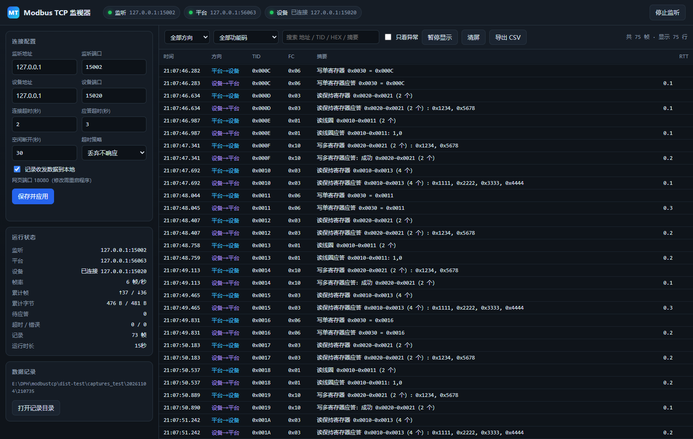
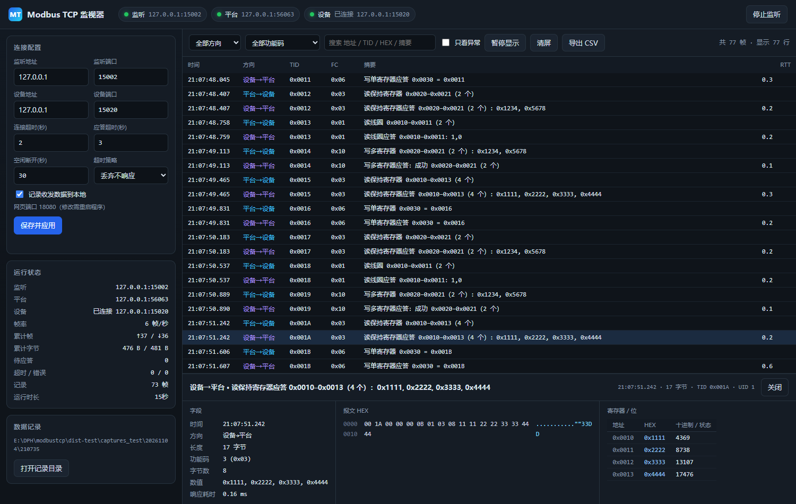

# Modbus TCP 监视器

> 透明代理 + 网页实时解析：不修改设备、不改写报文，看清平台与 Modbus TCP 设备之间的每一次收发。


A Modbus TCP monitoring proxy with a web UI. It relays frames between a SCADA/PLC client and a Modbus TCP device, decodes read/write register commands in real time, and records every frame to disk.



## 它解决什么问题

平台（TCP Client）与设备（TCP Server）直连，中间隔着网关。想抓包时：

- 交换机端口镜像需要可管理的交换机；流量经网关转发时，本机网卡根本看不到；
- ARP 欺骗在 Windows 上要装驱动、处理 TCP 序列号，容易把生产链路弄断。

本工具采用**应用层代理**：平台连它，它连设备，逐字节转发。代价只是把平台的目标 IP:端口改成运行本工具的电脑；换来的是双向数据 100% 可见，还能解析、落盘、统计超时。

## 功能

| 能力 | 说明 |
| --- | --- |
| 透明转发 | 按 MBAP 长度分帧，字节级原样转发，不改 TID/UID/PDU；解析失败也照转 |
| 协议解析 | FC 01/02/03/04/05/06/0F/10/17、异常应答（0x80+FC），读写多寄存器逐值展开 |
| 网页配置 | 监听地址/端口、设备地址/端口、超时策略、记录开关，保存即生效 |
| 实时监视 | 时间、方向、TID、FC、中文摘要、RTT；异常帧标红；按方向/功能码/关键字过滤 |
| 报文详情 | MBAP/PDU 字段、HEX + ASCII、寄存器地址/HEX/十进制、线圈位状态 |
| 断线处理 | 设备按需连接、0.5→5s 退避重连、平台重连接管旧连接、超时可代回 0x0B |
| 本地记录 | `data.log` / `data.csv` / `events.log` / `meta.json`，逐帧落盘、按大小滚动、按天清理 |

点击任意一帧可以看到字段、HEX + ASCII 与逐寄存器取值：



## 快速开始

### 方式一：直接运行 exe（现场推荐）

1. 从 [Releases](../../releases) 下载 `ModbusTcpMonitor_v1.0.0.zip`，解压到**可写目录**（不要放 `C:\Program Files`）。
2. 双击 `ModbusTcpMonitor.exe`。首次运行会在同目录生成 `config.json`，并自动打开 `http://127.0.0.1:8080/`。
3. 网页左侧填写**设备 IP/端口**和**监听端口**，点「保存并应用」。
4. 把平台的 Modbus 目标地址改为：**运行本工具的电脑 IP + 监听端口**（默认 502）。
5. 顶部三个指示灯变绿（监听 / 平台 / 设备）即链路正常。

> 设备侧不需要任何改动，平台侧只改目标 IP:端口这一处。

Windows 防火墙需放行监听端口和 8080。右键以管理员身份运行 `tools/开放防火墙端口.bat`，或手动：

```bat
netsh advfirewall firewall add rule name="ModbusMonitor 502" dir=in action=allow protocol=TCP localport=502
netsh advfirewall firewall add rule name="ModbusMonitor 8080" dir=in action=allow protocol=TCP localport=8080
```

### 方式二：从源码运行

```powershell
git clone <this-repo>
cd modbustcp
python app.py --no-browser
```

运行本身**零第三方依赖**（Python 3.10+ 标准库）。`requirements-dev.txt` 里的包只有打包和生成图标时才需要。

## 工作原理

```
平台 ──TCP Client──▶ 本程序 :502 ──TCP Client──▶ 设备 :502
                        │
                        └── 浏览器 http://本机:8080   (SSE 实时推送)
```

1. 平台连入后，代理才去连设备（按需连接），设备断线自动重连；
2. 请求登记 `TID → 写出的时间/解析结果`，设备应答按 TID 配对，得出 RTT 后转发回平台；
3. 每一帧**先落盘再转发**，掉电最多丢最后一条；
4. 网页通过 SSE 接收事件，浏览器慢只会丢 UI 事件，不会反压代理链路。

更细的设计（连接状态机、超时、背压、测试策略）见 [docs/design.md](docs/design.md)。

## 配置说明

配置文件为 exe 同目录的 `config.json`（首次运行自动生成），网页上修改后会写回该文件。字段含义：

| 字段 | 默认 | 说明 |
| --- | --- | --- |
| `listen_host` | `0.0.0.0` | 接平台的监听地址，`0.0.0.0` 表示所有网卡 |
| `listen_port` | `502` | 接平台的监听端口 |
| `device_host` | `192.168.1.100` | 设备 IP |
| `device_port` | `502` | 设备端口 |
| `web_host` | `0.0.0.0` | 网页监听地址 |
| `web_port` | `8080` | 网页端口，修改后需重启程序 |
| `connect_timeout` | `3.0` | 连接设备超时（秒） |
| `response_timeout` | `5.0` | 等待设备应答超时（秒），超时后按策略处理 |
| `idle_close` | `60.0` | 平台断开后保持设备链路的时间（秒），0 表示立即断开 |
| `timeout_policy` | `drop` | `drop` 静默丢弃；`exception` 由代理代回 0x0B 异常 |
| `address_offset` | `0` | 地址显示偏移，`0` 为 PDU 原始值，`1` 为 4xxxx 习惯 |
| `auto_start` | `true` | 启动程序时自动开始监听 |
| `auto_open_browser` | `true` | 启动后自动打开浏览器 |
| `record.enabled` | `true` | 是否记录收发数据 |
| `record.dir` | `captures` | 记录根目录（相对 exe 目录或绝对路径） |
| `record.flush` | `true` | 每帧 flush，掉电最多丢一条；关闭可提升吞吐 |
| `record.rotate_mb` | `64` | 单个日志文件上限（MB），超过后滚动 |
| `record.keep_days` | `7` | 记录保留天数，启动时清理更早的目录 |

热更新行为：改监听地址/端口会重建监听（平台需重连一次）；改设备地址/端口会重建设备链路；改记录开关/目录会新建记录会话；改 `web_port` 需重启程序。

## 记录文件

```text
captures/2026-11-04/210312/
├─ data.log     每帧一行：时间  方向  HEX（制表符分隔）
├─ data.csv     同上，带表头，Excel 可直接打开（UTF-8 BOM）
├─ events.log   连接、断开、超时等事件
└─ meta.json    本次记录的配置快照
```

`data.log` 示例：

```text
2026-11-04 21:03:18.127	平台→设备	000100000006010300100004
2026-11-04 21:03:18.128	设备→平台	00010000000B0103081111222233334444
```

- 单文件超过 `rotate_mb` 自动滚动为 `data_001.log`、`data_002.log`……
- 启动时删除超过 `keep_days` 的日期目录；
- 磁盘剩余不足 100MB 时停止记录并在网页提示，**转发不受影响**；
- 记录的是原始字节，解析结果是派生字段，可随时离线复算。

## 命令行参数

```text
python app.py [--config PATH] [--web-port 8080] [--listen-port 502]
              [--device 192.168.1.50:502] [--no-browser] [--debug]
```

| 参数 | 说明 |
| --- | --- |
| `--config` | 指定配置文件，便于维护多套现场配置 |
| `--web-port` | 覆盖网页端口 |
| `--listen-port` | 覆盖监听端口 |
| `--device host:port` | 覆盖设备地址 |
| `--no-browser` | 启动后不自动打开浏览器 |
| `--debug` | 输出调试日志 |

## 构建 exe

```powershell
powershell -ExecutionPolicy Bypass -File tools\build.ps1
```

脚本会创建 `.venv`、安装 PyInstaller、跑测试、生成图标并打包，输出 `dist\ModbusTcpMonitor.exe`（单文件，目标机无需 Python）。

手动等价命令：

```powershell
py -3.13 -m venv .venv
.\.venv\Scripts\pip install pyinstaller pillow
.\.venv\Scripts\python -m unittest discover -s tests -v
.\.venv\Scripts\python -m PyInstaller --onefile --console --icon assets\app.ico ^
  --version-file tools\version_info.txt --name ModbusTcpMonitor ^
  --add-data "modbus_proxy\static;modbus_proxy\static" app.py
```

## 测试

```powershell
python -m unittest discover -s tests -v
```

覆盖：MBAP 分帧（粘包/半包/重同步）、各功能码请求与应答、异常帧、地址偏移、写多寄存器、设备断线重连、平台重连接管、超时策略、落盘内容校验。

本仓库还带一套本地联调脚本：

```powershell
python tests/fake_device.py 15020                 # 假设备（含异常与不响应场景）
python app.py --config tests/dev-config.json      # 用测试端口启动：15002 / 15020 / 18080
python tests/fake_platform.py 15002               # 假平台，逐项校验转发与解析
python tests/fake_platform_loop.py 15002          # 持续轮询，用于观察网页
```

## 常见问题

**平台连不上，监听灯是红的**
监听端口被占用（常见于已经有一个实例在跑，或本机装了其它 Modbus 从站软件）。换端口或结束占用进程；日志在 `logs/system.log`。

**设备灯一直「未连接」**
设备链路是按需连接的：平台连上并发出第一帧后才会去连设备。若平台已连、设备仍连不上，检查设备 IP/端口，以及设备是否只允许一条连接（别处还连着会被拒）。

**平台请求超时**
帧表里会显示「设备应答超时 TID=…」。设备慢就调大 `response_timeout`；希望平台立刻得到反馈，就把 `timeout_policy` 设为 `exception`，代理会代回网关异常 `0x0B`。

**RTT 是什么**
代理把请求写进设备 socket，到收到该 TID 应答之间的耗时（毫秒），衡量的是设备与网络这一段，不含平台到代理的传输。没有配对请求的帧（如设备主动上报）RTT 为空。

**换了监听端口后平台断了**
正常现象：监听端口变更会重建监听，平台需要重连一次。

**网页打不开**
看控制台打印的「网页界面」地址；8080 被占用时会自动顺延到 8081、8082……

**Windows 提示「已保护你的电脑」**
exe 未签名。点「更多信息 → 仍要运行」；若被杀软隔离，把程序目录加入白名单。

## 限制

- 同一时刻只服务 **1 个平台连接**（面向设备只允许单 TCP 连接的场景）；
- 只解析 Modbus TCP（MBAP）；未识别到 MBAP 头时自动退化为原样转发，只记 HEX；
- 不做协议改写、不做缓存应答、不支持 TLS；
- 网页与 Modbus 端口**没有认证**，请只在可信内网使用；
- exe 仅提供 Windows x64 构建；源码未使用平台专属 API，Linux/macOS 理论可用但未充分测试。

## 目录结构

```text
.
├─ app.py                      入口：配置、日志、启动代理与网页
├─ modbus_proxy/
│  ├─ config.py                配置定义与校验
│  ├─ mbap.py                  MBAP 分帧、PDU 解码、中文摘要
│  ├─ proxy.py                 双向转发、连接管理、超时、重连
│  ├─ recorder.py              data.log / data.csv 落盘与滚动
│  ├─ webapp.py                HTTP + REST + SSE
│  └─ static/                  网页前端（原生 JS，无构建步骤）
├─ tests/                      单元测试与假设备/假平台脚本
├─ tools/                      打包、图标、防火墙脚本
├─ docs/                       截图与设计说明
├─ assets/app.ico              应用图标
└─ config.example.json         配置示例（完整字段）
```

## 许可证

[MIT](LICENSE)
